

  

    English · <a href="README.md">Türkçe</a>
  

  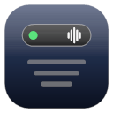
  <h1>NookBar - A Dynamic Island for Windows</h1>
  

    NookBar is a Dynamic Island for Windows 10/11 that brings the music that is playing, your notifications, system readings and wireless device batteries to the top of your screen, with clipboard history and a file shelf.
  

  

    It stays as a small island at the top of the screen and opens only when you need it. 
    A light, native Windows app with no third-party dependencies. <b>Early access</b> — free; your feedback matters a lot.
  

  

    <a href="../../releases/latest"><b>Download</b></a> · <a href="CHANGELOG.en.txt">Release history</a> · <a href="../../issues/new/choose">Request device support</a>
  

  

    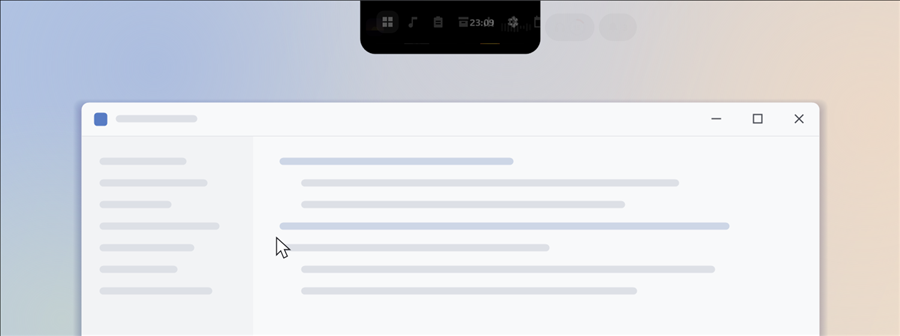
  

## Why NookBar

- **Everything in one place:** Music, notifications, device batteries, timer, clipboard, file shelf and system info at the edge of your screen; no extra windows or apps to open.
- **Starts small, opens when needed:** It sits at the top; hover and it opens, move away and it closes.
- **Media control:** Cover art of the playing track, bars driven by the real audio spectrum and synced lyrics on the island.
- **System monitor:** CPU, RAM, disk and network graphs, plus volume and brightness sliders.
- **Device batteries:** Wireless mouse, keyboard, headset and controller batteries with low-battery color alerts. Logitech devices use their G HUB names.
- **Clipboard and file shelf:** Re-copy what you copied in one click; drag files onto the island and drop them wherever you like.
- **No interruptions in full screen:** It hides itself in games and fullscreen video.
- **Works out of the box:** No account, API key or extra sign-in needed.
- **Native Windows app:** Written in C++, about 3 MB installed; no browser engine or runtime.
- **English and Turkish:** The language follows Windows and can be changed in Settings.

## Features

### Collapsed styles

NookBar sits at the top center of the screen and comes in two styles: **Island** (default) and **Notch**. Double-click an empty area to drop it to a thin line.

| Island (default) | Notch |
| :---: | :---: |
| 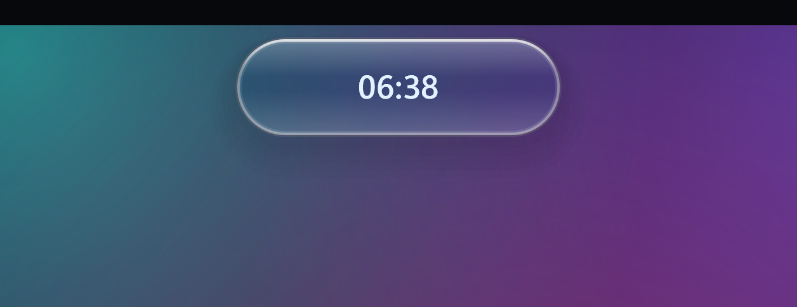 | 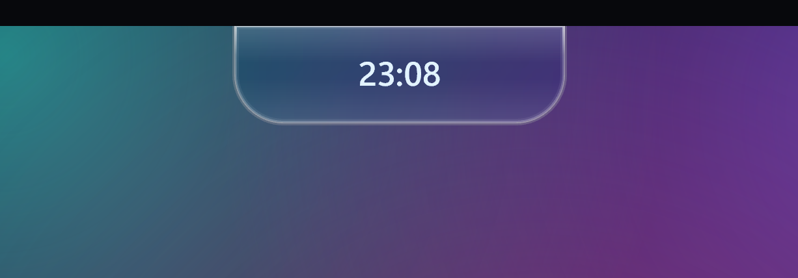 |
| A floating capsule detached from the screen | A notch attached to the screen edge |
| 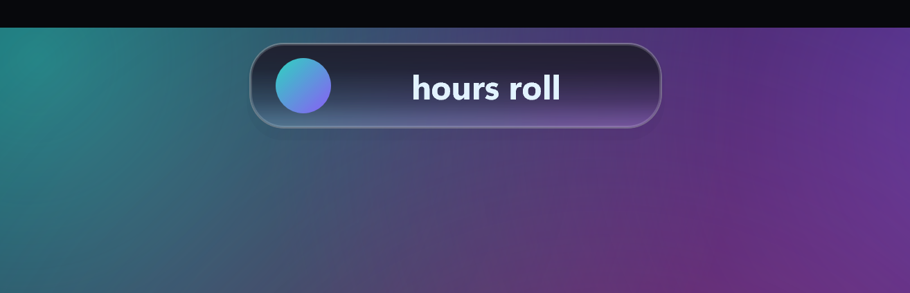 | 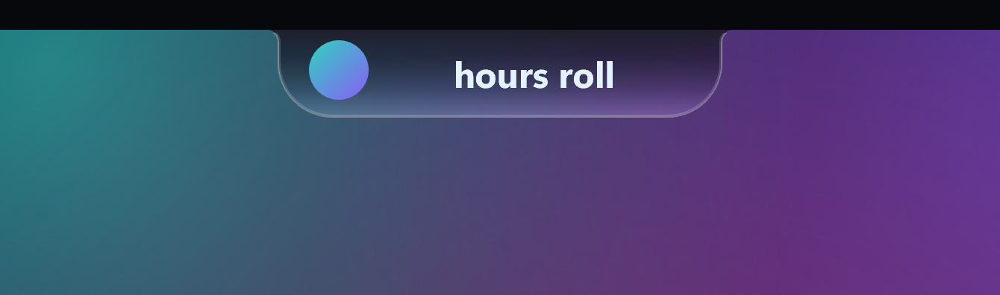 |
| While music plays: cover and lyric | While music plays: cover and lyric |

- While music plays it becomes a slim indicator: the album cover (or the playing app's icon) on the left and the lyric next to it. The island widens and narrows with the current lyric phrase. During rhythm/instrumental gaps between lyrics, and for tracks without lyrics, dots that react to the audio appear. When no music plays, the clock sits in the center of the capsule.
- While music plays, the closed island can show the visualizer, only the clock or **your own text** (one line, up to 32 characters, adjustable size) instead of lyrics. Text is centered on the island according to its width.

  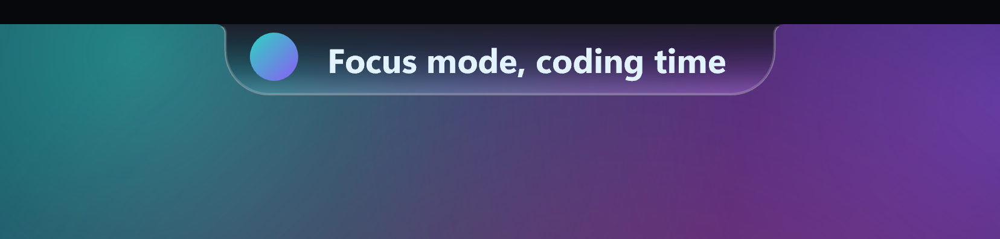

- Hiding with `Ctrl + Alt + D` pulls the island into the edge like a water drop; showing it forms a drop at the edge that opens into the island.
- A timer ring appears on the left; an unread notification counter, download indicator and battery capsule on the right.
- 8 positions: top, bottom, corners and left/right edges (vertical capsule on the sides); multi-monitor and DPI aware.
- Quick volume: scroll the mouse wheel over the closed island.

### Music

  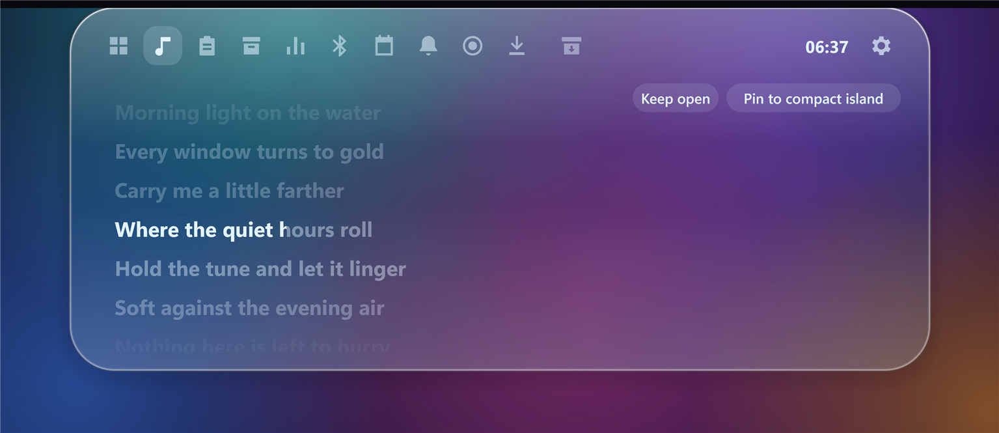

- Playing track, cover art, progress bar, play/pause/skip controls.
- **Real audio spectrum:** the bars follow system audio in 16 frequency bands (bass on the left, treble on the right); if audio can't be captured they fall back to an animation.
- Synced lyrics: on the compact island, in the lyrics wheel on the music card and in the Lyrics tab; click a line and the song jumps there. The current line fills from left to right with the song.
- **Lyric sync:** lyrics are split into balanced phrases by syllable count and aligned within each line to the vocal onsets in the audio; learned corrections are stored per song on your computer and applied from the first second the next time the song plays. Phrase length (2/3/4 words) and a lyric offset are in Settings → Media.
- The music card takes an accent from the cover color; on a wide card the cover and controls sit on the left and the lyrics wheel on the right. Long titles scroll, and content longer than an hour shows hours in the time.

  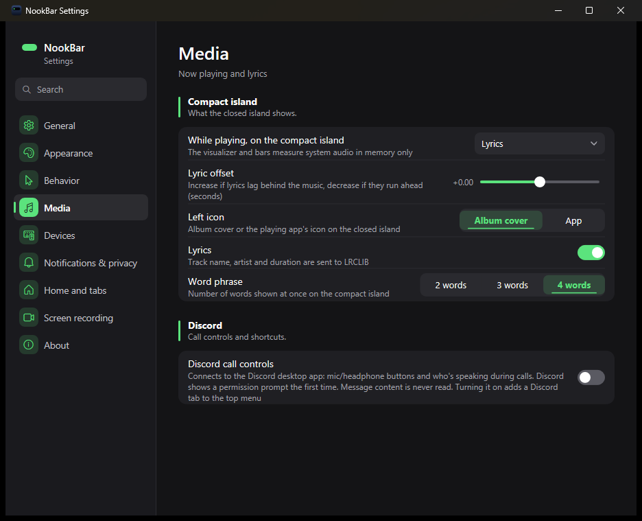

### Discord (optional)

- Connects locally to the Discord desktop app: microphone/headphone buttons during a call, who is speaking, screen share and camera shortcuts. Message content is not read.
- Off by default. Discord only allows the local connection on the app owner's account, so you need to create your own Discord app and enter its Client ID in Settings → Media → Discord (steps are on the settings screen).

### System

  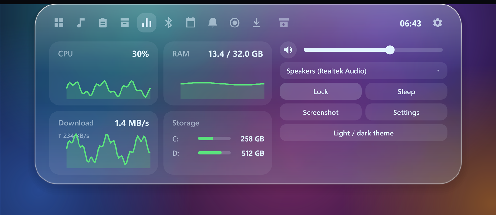

- CPU, RAM, disk and network graphs; storage bars for all drives.
- Volume and brightness sliders, audio output picker, quick actions such as lock, sleep and screenshot.
- MP4 screen recording (screen + system audio/microphone), pause, and a recordings list.

### Wireless device batteries

  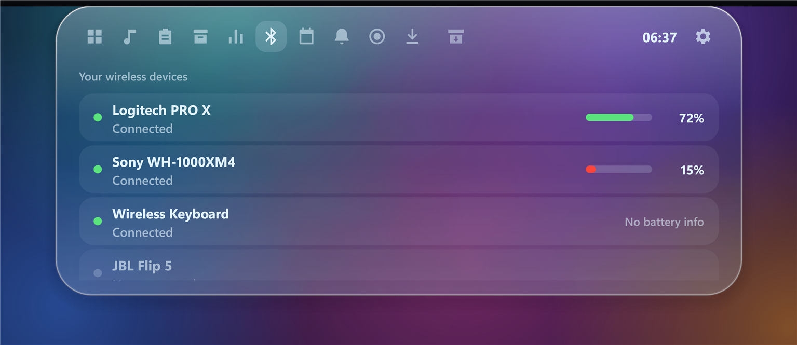

  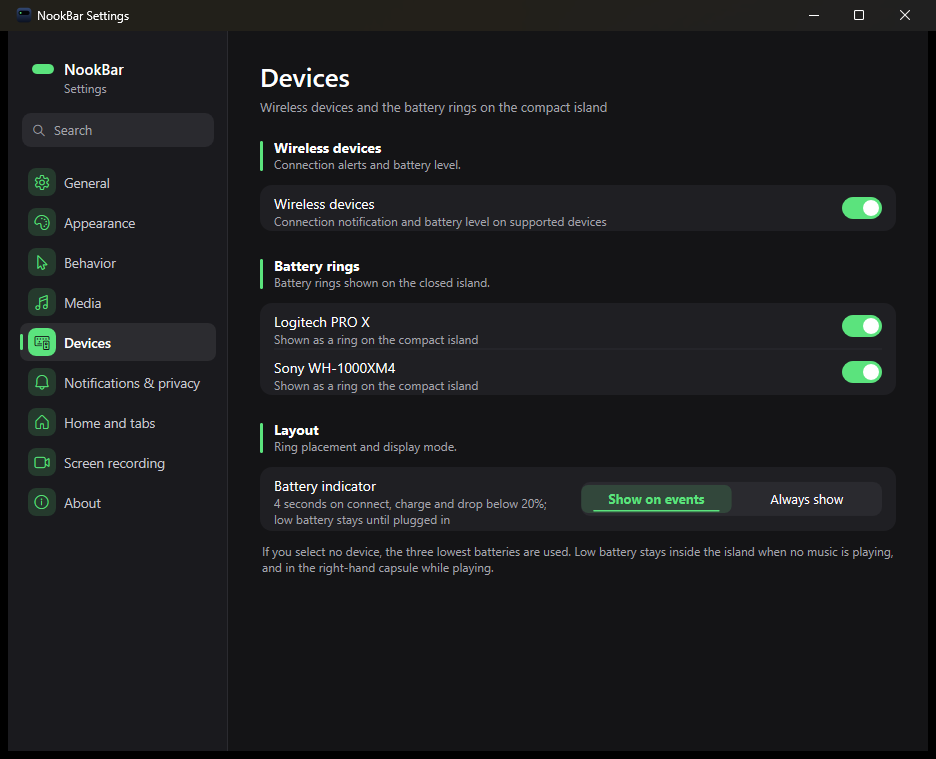

- Mice, keyboards, headsets and controllers; Logitech devices are shown with their G HUB name ("PRO X SUPERLIGHT").
- On connect, charge or a drop below 20% the battery capsule shows for 4 seconds; low battery stays until plugged in.
- Optional battery rings on the closed island; choose which devices get a ring and the layout in Settings → Devices.
- Battery data comes from read-only queries; no settings or reset commands are ever sent to a device. [Supported devices](#supported-wireless-devices)

### Clipboard and file shelf

  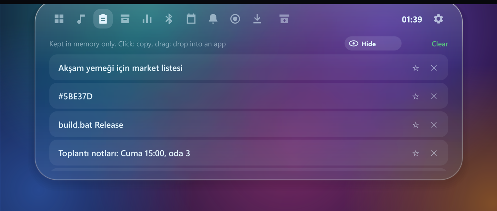

  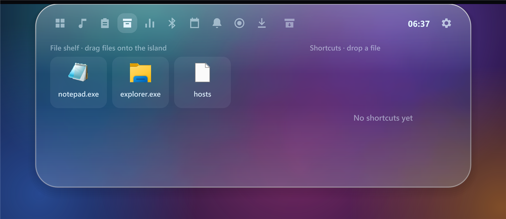

- **Clipboard:** text, images and files are kept in memory only; click to copy again, drag to drop into another window, star to pin.
- Text that looks like a password, API key or verification code is masked with `•••`; while a streaming/recording app runs, the clipboard hides itself.
- **File shelf:** drop files onto the island, then drag them wherever you like; right-click: Open, Show in folder, Copy, Share, Remove. Files are never copied, only their paths are kept.

### Notifications and downloads

  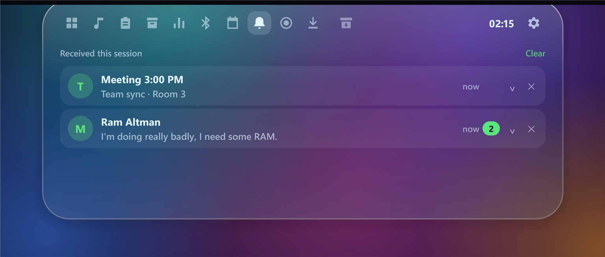

- Windows notifications are shown one at a time through a priority queue; notifications from the same app are grouped in one card.
- Alarms, reminders and time-ups jump ahead; waiting ones are counted by a `+N` badge.
- Browser and Internet Download Manager downloads appear to the right of the island with name and speed; the Downloads tab keeps a history.

### Tools

  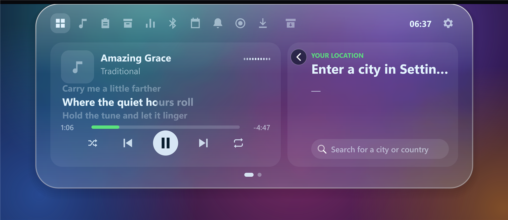

- Timer (countdown, stopwatch, alarm), pomodoro, agenda and notes with reminders, to-dos, world clock.
- A draggable 3D globe with weather on the home page.

### Themes and appearance

  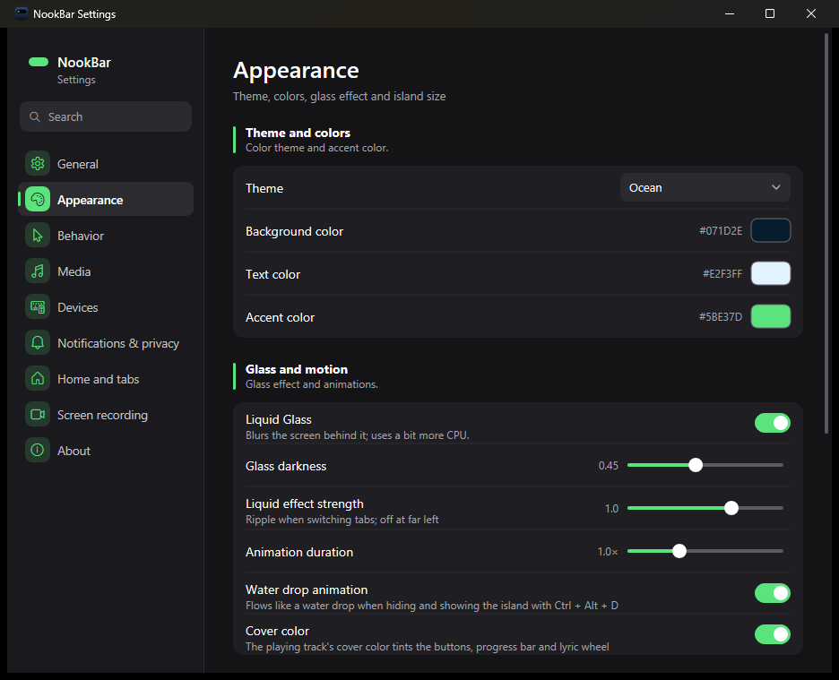

- 14 built-in themes, custom background/text/accent colors.
- **Font:** pick any installed font (a searchable list that scrolls with the mouse wheel; every name is shown in its own font) or upload your own TTF/OTF file. An uploaded font is used only in NookBar and is not installed in Windows.

  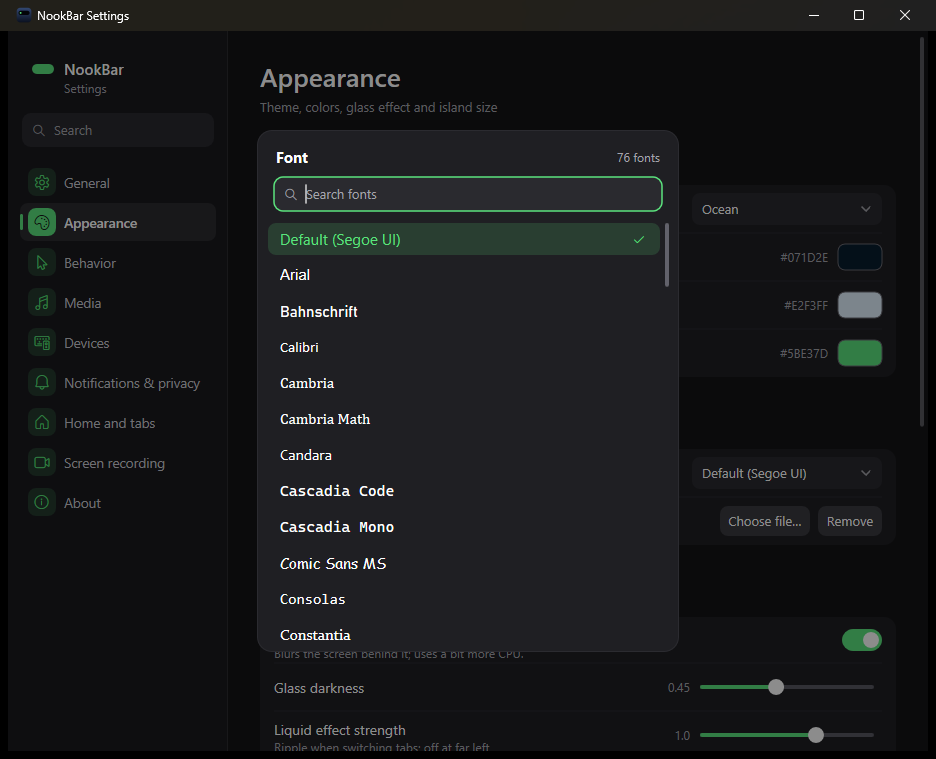

- **Liquid Glass** (blurs and refracts the screen behind it), a liquid tab transition and an accent from the cover color.
- If Windows "Transparency effects" are off or High Contrast is on, the body is drawn opaque; if "Animation effects" are off, transitions use the fastest setting.
- Island size, corner roundness and animation duration are adjustable.

### More settings

- **Settings window:** a categorized sidebar, described sections, segmented choices for settings with few options, a position picker on a small screen mock-up and search across all settings (`Ctrl + F`).
- **Shortcuts:** `Ctrl + Alt + D` shows/hides the island (water drop animation, can be turned off in Settings → Appearance); `Ctrl + Alt + Space` opens/closes the panel; while open, ←/→ switch tabs and `Esc` closes. The settings window is fully usable with Tab/arrows/Space.
- **Open mode:** on hover or on click; follow the screen the cursor is on; a reveal-on-edge mode.
- **Hiding:** hide in fullscreen and when a window is maximized; double-click to drop to a thin line.
- **Screen sharing:** the island is visible in Discord/OBS/Teams; hide it in shares and recordings if you prefer.
- **Updates:** when a new version is out, the island tells you once; a download link in the tray menu and in Settings → About.
- **Language:** Settings → General → Language (Automatic, Türkçe, English), the tray menu or first-run setup.
- **Tab order:** drag tabs in the top menu to reorder, drop the ones you don't use on the box icon to hide them.

## Supported wireless devices

| Brand / family | Connection |
|---|---|
| Logitech (mice, keyboards, G headsets) | Through G HUB if running, otherwise directly via HID++ |
| Razer (including BlackShark V3 / V3 Pro), SteelSeries, Corsair, HyperX, ASUS ROG | 2.4 GHz receiver / cable |
| Sony INZONE, Jabra, JBL Quantum, Fractal Scape, MOONDROP | 2.4 GHz receiver |
| AirPods / Beats, Samsung Galaxy Buds | Bluetooth |
| Glorious, LAMZU, G-Wolves, Hitscan, WLMouse, Pulsar, ATK/VXE, Endgame Gear, ZOWIE, VAXEE, Ninjutso | 2.4 GHz receiver / cable |
| Akko and Rongyuan-based receivers, AJAZZ, AULA, MCHOSE, Keychron, Rapoo, Redragon, Delux, Attack Shark | 2.4 GHz receiver |
| PlayStation (DS4 / DualSense), Xbox, GameSir, Flydigi, Steam Controller | USB / Bluetooth / receiver |
| Devices exposing standard HID battery info, Android phone (Phone Link) | — |

Full list and protocol sources: [KAYNAKLAR.md](docs/KAYNAKLAR.md) (Turkish). If your device doesn't show up, [open a device support request](../../issues/new/choose).

## Installation

Requires Windows 10 or 11 (x64).

1. Download `NookBar-Setup-<version>.exe` from [Releases](../../releases/latest) and run it.
   - No administrator permission needed; it installs to `%LOCALAPPDATA%\Programs\NookBar`.
   - Your settings and notes live in `%APPDATA%\DinamikAdaNative` (kept for compatibility with the old name).
2. If Windows shows an "Unknown publisher" warning, choose **More info → Run anyway**. The app is not code-signed yet.
3. If **Smart App Control** (Windows Security → App & browser control) is on, unsigned apps may be blocked.
4. On first launch a short wizard asks for language, position, appearance and home page.

### Virus scan

In the VirusTotal scan of 27 November 2026, 66 of 69 engines did not detect anything in `NookBar-Setup-1.0.16.exe` (including Kaspersky, ESET and BitDefender). 3 engines flagged it: CrowdStrike Falcon, Microsoft and SecureAge. In the first scan on 26 November 2026 Microsoft found nothing and Rising flagged it. Current result: [VirusTotal report](https://www.virustotal.com/gui/file/2be2e070ecb4067a8f0efa5ef98ccc28a744e95d9b6d2ac5029e36211793b16c).

We'd rather show these flags openly than hide them:

- None of the three points to a specific threat or behavior. CrowdStrike's is an automated (machine learning) guess at 60% confidence; Microsoft's also comes from a machine learning model, as the `!ml` suffix in its name shows. NookBar isn't code-signed yet and the file is new; automated systems like these flag such files more often.
- We also ran the 1.0.15 installer in a sandbox on [Hybrid Analysis](https://hybrid-analysis.com/sample/adc1d30348197c7614472a942ea135a2409f57f891a351a7f003ee54f3a08a5a). Most flags there are about what the installer does: writing the program to disk, saving the "Start with Windows" choice in the registry, and cleaning up an old "Dinamik Ada" install. The site's overall verdict is still "Malicious"; of the 25 antivirus engines there, CrowdStrike is the only one that flags it.
- On 26 November 2026 we sent false-positive reports for both 1.0.15 and 1.0.16 to CrowdStrike and SecureAge. On 27 November 2026 we also submitted 1.0.16 to Microsoft as a false positive; the review is pending. Our email to Rising's reporting address bounced; we'll try another way. We'll update this section as replies come in.
- The full reports are at the links above, so you can judge for yourself.

You can check that your download is the same file by its SHA-256 hash: `2be2e070ecb4067a8f0efa5ef98ccc28a744e95d9b6d2ac5029e36211793b16c`

## Quick start

1. NookBar opens as a small island at the top center of your screen.
2. Hover the island: the panel opens. Move away and it closes.
3. Switch tabs with the icons at the top (or scroll the mouse wheel over them); home cards are paged.
4. Settings: the gear at the top of the panel or the taskbar icon. All tips: Settings → About → How to use.

## Uninstallation

Windows Settings → Apps → NookBar → Uninstall. If you tick "Also delete my settings and notes" in the uninstaller, `%APPDATA%\DinamikAdaNative` is deleted too.

## Privacy

- Clipboard history and notifications are kept in memory only and deleted when the app exits. While you broadcast or record (an app like OBS or a NookBar recording), the clipboard and notification text hide themselves. Discord/Teams screen sharing can't be detected; for that, turn on "Hide in screen sharing and recordings".
- The network is used only for these features: lyrics (on by default; the title, artist and duration of whatever is playing, browser videos included, go to LRCLIB; turn it off in Settings → Media → Lyrics), weather (the city you type to Open-Meteo), Discord (if enabled, Discord's sign-in server), update check (only the latest version number is requested from GitHub; can be turned off in Settings → About). No telemetry.
- After an unexpected close, a short error report stays only on your computer; nothing is sent automatically. If you like, Settings → About → Error reports opens the technical summary (version, Windows, error code) as an issue on GitHub.
- For lyric sync, audio is measured in memory only and never recorded. Learned lyric corrections (song name and numbers) stay on your computer in `%APPDATA%\DinamikAdaNative`.
- Download history (file name and path of finished downloads) also stays on your computer, in `downloads.json` in the same folder.
- The dump file (.dmp) in the error reports folder may contain pieces of memory from the moment of the crash; don't attach it to a public issue.
- The Discord session is stored with Windows' per-user encryption (DPAPI); NookBar only connects to a local endpoint that really is Discord.
- Wireless device batteries are read on your computer; for G HUB the other end is verified to really be G HUB.

## Games and anti-cheat

NookBar is written to run safely next to games, but no anti-cheat officially declares a program "safe", so no absolute guarantee can be given. What you should know:

- **It doesn't touch the game.** It doesn't inject code into the game, doesn't read or change its memory and installs no kernel driver. The island is drawn as a separate window on top (it doesn't go inside the game like the Discord and Steam overlays).
- **It doesn't interfere with input.** No mouse/keyboard hooks, macros or auto-clicking. The only synthetic key press is for the Discord shortcut buttons, and it is sent only while Discord is in front.
- **Game mode (on by default):** while a fullscreen game runs, the screen isn't copied for the glass look and no keys are sent to Discord. Settings → Behavior → Hiding → Game mode.
- **Hide in fullscreen (on by default):** the island disappears completely while you play.
- Battery levels are read from headsets and mice the same way vendor apps do (HID).
- NookBar isn't code-signed yet. Strict kernel-level systems (such as Vanguard or FACEIT) may stop unsigned programs from drawing over the game; that isn't a ban, the island just doesn't show. If you want to be careful, quit NookBar from the tray menu before competitive matches.

## Troubleshooting

**My device's battery doesn't show.** Look for the model in the [supported devices](#supported-wireless-devices) list. If it's missing, start with the `DINAMIKADA_BATLOG=1` environment variable and attach the resulting `%TEMP%\dinamikada_battery.txt` to a device support request.

**The island shows up in Discord / OBS.** That is the default. To hide it: Settings → Notifications & privacy → "Hide in screen sharing and recordings".

**The audio bars don't move.** The bars follow the system audio Windows is playing; if audio can't be captured they fall back to an animation. Also check Windows Accessibility → Visual effects → Animation effects.

**How do I change the language?** Settings → General → Language, or right-click the tray icon → Language.

**The app won't start / is blocked.** Smart App Control can block unsigned apps; see [Installation](#installation).

## Feedback

NookBar is in early access. Report problems and feature ideas through [Issues](../../issues); for device support, include the model and connection type. This repository only hosts installers and documentation.

## License

Copyright © 2026 NookBar. All rights reserved. See [LICENSE](LICENSE). Map data is from Natural Earth (public domain); wireless protocol sources are listed in [KAYNAKLAR.md](docs/KAYNAKLAR.md).
