

  

    <a href="README.en.md">English</a> · Türkçe
  

  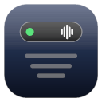
  <h1>NookBar - Windows için Dinamik Ada</h1>
  

    NookBar, çalan müziğini, bildirimlerini, sistem bilgilerini ve kablosuz cihazlarının pilini; pano geçmişi ve dosya rafıyla birlikte ekranının üstüne taşıyan bir Windows 10/11 dinamik adasıdır.
  

  

    Ekranın üstünde küçük bir ada olarak bekler, yalnızca ihtiyaç duyduğunda açılır. 
    Hafif, yerel bir Windows uygulaması: üçüncü taraf bağımlılığı yok. <b>Erken erişim</b> — ücretsiz; geri bildirimin çok değerli.
  

  

    <a href="../../releases/latest"><b>İndir</b></a> · <a href="CHANGELOG.txt">Sürüm geçmişi</a> · <a href="../../issues/new/choose">Cihaz desteği iste</a>
  

  

    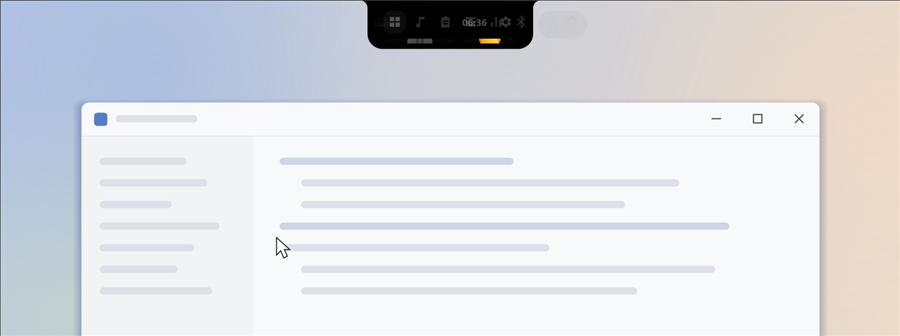
  

## Neden NookBar

- **Her şey tek yerde:** Müzik, bildirimler, cihaz pilleri, zamanlayıcı, pano, dosya rafı ve sistem bilgisi ekranın kenarında; ayrı pencere ya da uygulama açmak yok.
- **Küçük başlar, gerektiğinde açılır:** Üstte durur; üzerine gel, açılır; fareyi çek, kapanır.
- **Müzik kontrolü:** Çalan parçanın kapağı, gerçek ses spektrumuna göre oynayan çubuklar ve sesle hizalanan zamanlı şarkı sözleri adada.
- **Sistem bilgisi:** CPU, RAM, disk ve ağ grafikleri, ses ve parlaklık kaydırıcıları.
- **Cihaz pilleri:** Kablosuz fare, klavye, kulaklık ve kolların pili; düşük pilde renkli uyarı. Logitech cihazları G HUB'daki adla görünür.
- **Pano ve dosya rafı:** Kopyaladıklarını tek tıkla yeniden yapıştır; dosyaları adaya sürükleyip istediğin yere bırak.
- **Tam ekranda rahatsız etmez:** Oyun ve tam ekran videolarda kendiliğinden gizlenir.
- **Kutudan çıktığı gibi çalışır:** Hesap, API anahtarı ya da ek bir giriş gerekmez.
- **Yerel Windows uygulaması:** C++ ile yazıldı, kurulum yaklaşık 3 MB; tarayıcı motoru ya da çalışma zamanı yok.
- **Türkçe ve İngilizce:** Dil Windows'a göre seçilir, Ayarlar'dan değiştirilir.

## Özellikler

### Kapalı biçimler

NookBar ekranın üst ortasında durur ve iki biçimde gelir: **Ada** (varsayılan) ve **Çentik**. Boş yerine çift tıklayınca ince çizgiye iner.

| Ada (varsayılan) | Çentik |
| :---: | :---: |
| 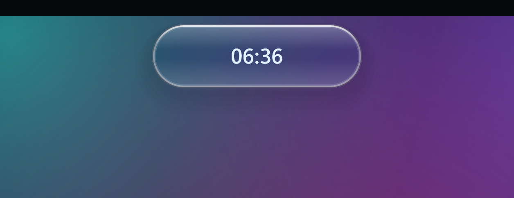 | 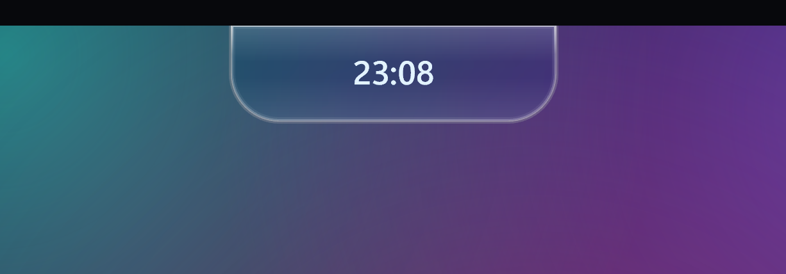 |
| Ekrandan ayrık yüzen kapsül | Ekran kenarına bitişik çentik |
| 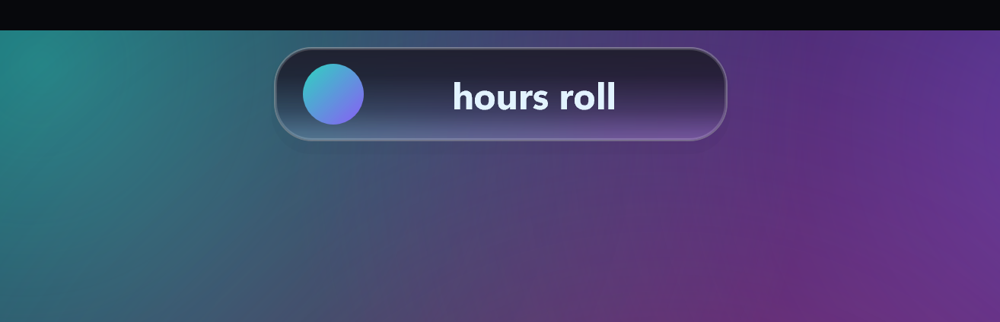 | 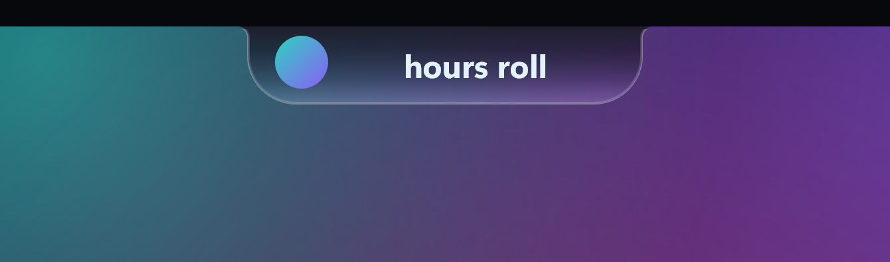 |
| Müzik çalarken: kapak ve söz | Müzik çalarken: kapak ve söz |

- Müzik çalarken ince bir gösterge olur: solda albüm kapağı (ya da çalan uygulamanın simgesi), yanında şarkı sözü. Ada, çalan söz öbeğine göre genişleyip daralır. Sözler arasındaki ritim/enstrümantal boşlukta ve sözü olmayan parçalarda sesle oynayan noktalar görünür. Müzik çalmıyorsa saat kapsülün ortasında durur.
- Müzik çalarken kapalı adada söz yerine görselleştirici, yalnızca saat ya da **kendi yazın** (tek satır, en çok 32 karakter, boyutu ayarlanır) gösterilebilir. Yazılar genişliklerine göre adanın ortasına hizalanır.

  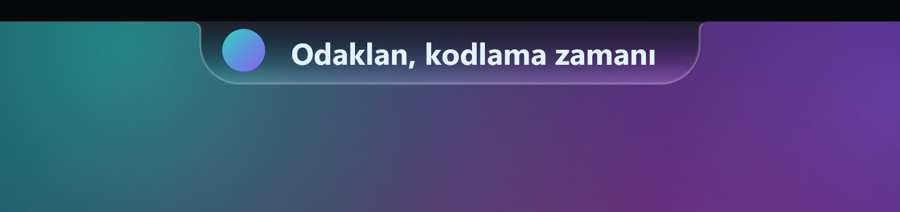

- `Ctrl + Alt + D` ile gizlerken ada su damlası gibi kenara çekilir, gösterirken kenarda bir damla oluşup adaya açılır.
- Solda zamanlayıcı halkası, sağda okunmamış bildirim sayacı, indirme göstergesi ve pil kapsülü çıkar.
- 8 konum: üst, alt, köşeler ve sol/sağ kenar (kenarlarda dikey kapsül); çoklu ekran ve DPI desteği.
- Hızlı ses ayarı: kapalı adanın üzerinde fare tekerleği.

### Müzik

  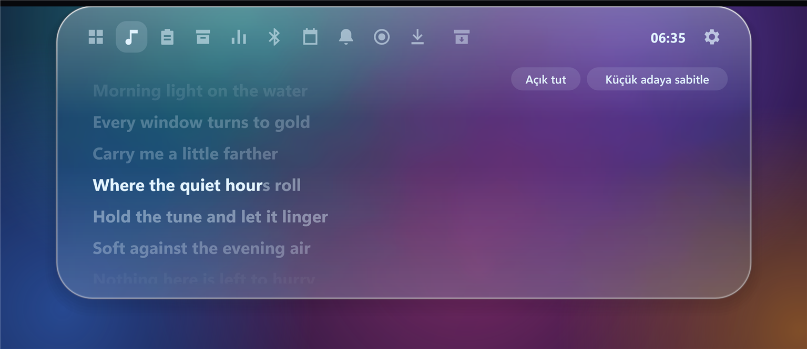

- Çalan parça, kapak, ilerleme çubuğu, oynat/duraklat/atla kontrolleri.
- **Gerçek ses spektrumu:** çubuklar sistem sesinden 16 frekans bandıyla çalışır (bas solda, tiz sağda); ses yakalanamazsa animasyona döner.
- Zamanlı şarkı sözleri: küçük adada, müzik kartındaki söz çarkında ve Sözler sekmesinde; satıra tıklayınca şarkı oraya atlar. Çalan satır şarkıyla birlikte soldan sağa dolar.
- **Söz senkronu:** sözler hece sayısına göre dengeli öbeklere bölünür ve vokalin sesteki girişlerine göre satır içinde hizalanır; öğrenilen düzeltmeler şarkı başına bilgisayarında saklanır, aynı şarkı tekrar çalınınca ilk saniyeden uygulanır. Ayarlar → Medya'da öbek uzunluğu (2/3/4 kelime) ve söz kaydırma.
- Müzik kartı kapak renginden vurgu alır; geniş kartta kapak ve kontroller solda, söz çarkı sağda. Uzun başlıklar kayar, bir saati aşan içerikte süre saatli gösterilir.

  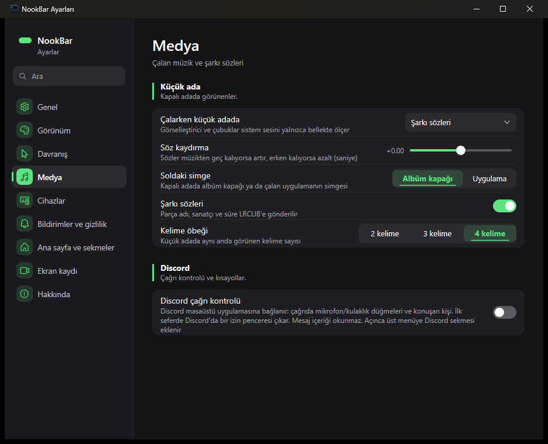

### Discord (isteğe bağlı)

- Discord masaüstü uygulamasına yerelden bağlanır: çağrıdayken mikrofon/kulaklık düğmeleri, konuşan kişi, ekran paylaşımı ve kamera kısayolları. Mesaj içeriği okunmaz.
- Varsayılan olarak kapalıdır. Discord yerel bağlantıya yalnızca uygulama sahibinin hesabında izin verdiği için kendi Discord uygulamanı oluşturup Client ID'sini Ayarlar → Medya → Discord'a yazman gerekir (adımlar ayar ekranında).

### Sistem

  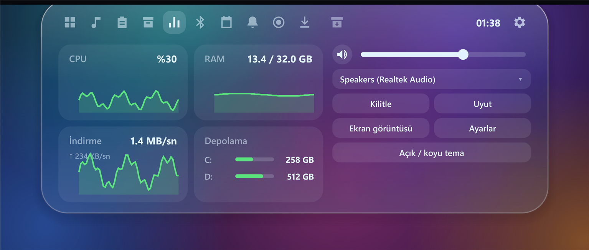

- CPU, RAM, disk ve ağ grafikleri; tüm sürücüler için depolama çubukları.
- Ses ve parlaklık kaydırıcıları, ses çıkışı seçimi, kilitle/uyut/ekran görüntüsü gibi hızlı işlemler.
- MP4 ekran kaydı (ekran + sistem sesi/mikrofon), duraklatma, kayıt listesi.

### Kablosuz cihaz pilleri

  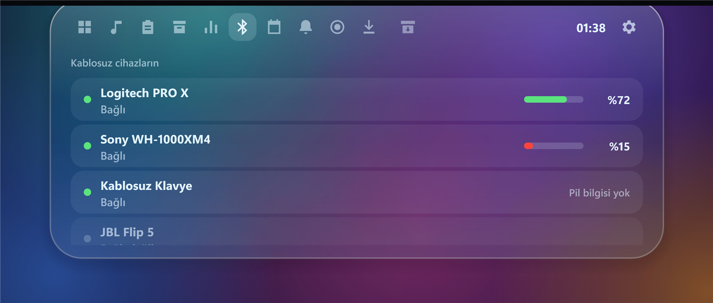

  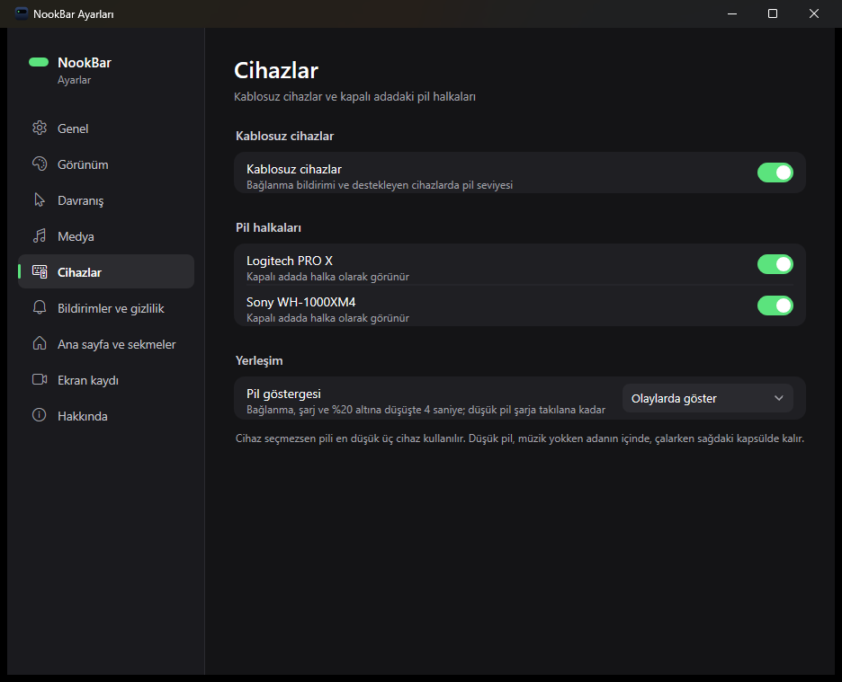

- Fare, klavye, kulaklık ve kollar; Logitech cihazları G HUB'daki adla ("PRO X SUPERLIGHT") gösterilir.
- Bağlanma, şarj ya da %20 altına düşüşte pil kapsülü 4 saniye görünür; düşük pil şarja takılana kadar kalır.
- İstersen kapalı adada pil halkaları; hangi cihazların halka alacağını ve yerleşimi Ayarlar → Cihazlar'dan seç.
- Pil bilgisi yalnızca okuma sorgularıyla alınır; cihaza hiçbir ayar ya da sıfırlama komutu gönderilmez. [Desteklenen cihazlar](#desteklenen-kablosuz-cihazlar)

### Pano ve dosya rafı

  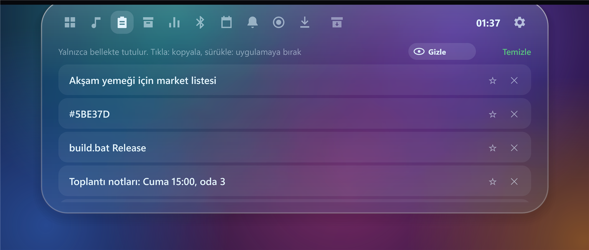

  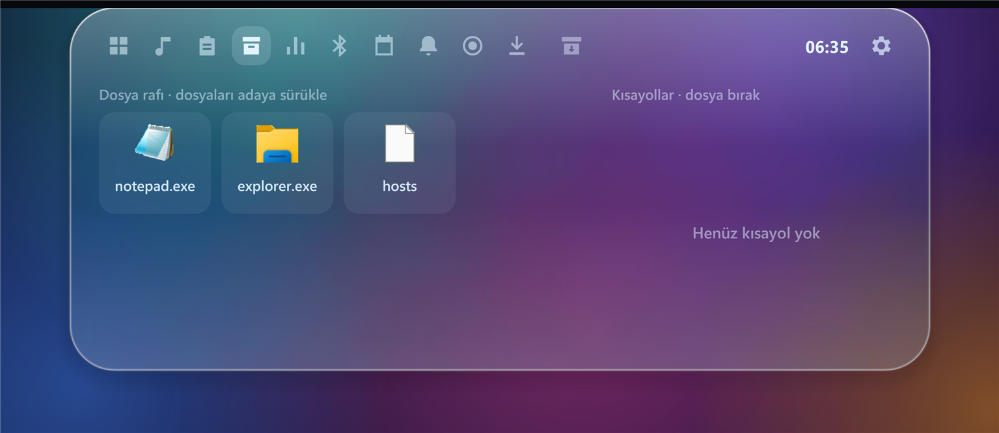

- **Pano:** metin, görsel ve dosyalar yalnızca bellekte tutulur; tıkla yeniden kopyala, sürükle başka pencereye bırak, yıldızla sabitle.
- Parola, API anahtarı ve doğrulama kodu gibi görünen metinler `•••` ile maskelenir; yayın/kayıt uygulaması çalışırken pano kendiliğinden gizlenir.
- **Dosya rafı:** dosyaları adaya bırak, sonra istediğin yere sürükle; sağ tık: Aç, Klasörde göster, Kopyala, Paylaş, Kaldır. Dosyalar kopyalanmaz, yalnızca yolları tutulur.

### Bildirimler ve indirmeler

  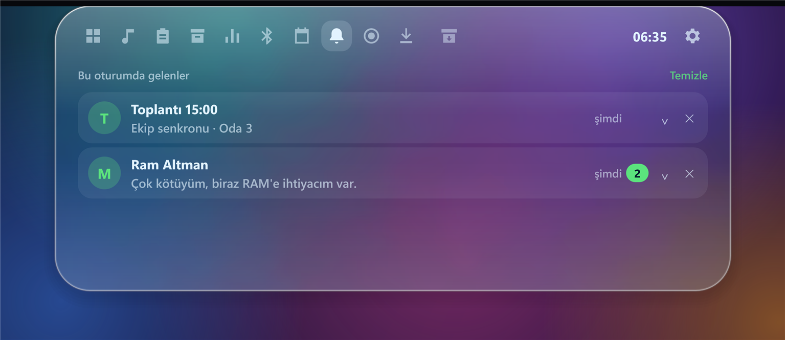

- Windows bildirimleri öncelikli kuyrukla sırayla gösterilir; aynı uygulamanın bildirimleri tek kartta toplanır.
- Alarm, hatırlatma ve süre dolumu öne geçer; bekleyenler `+N` rozetiyle sayılır.
- Tarayıcı ve Internet Download Manager indirmeleri adanın sağında ad ve hızla görünür; İndirmeler sekmesinde geçmişi tutulur.

### Araçlar

  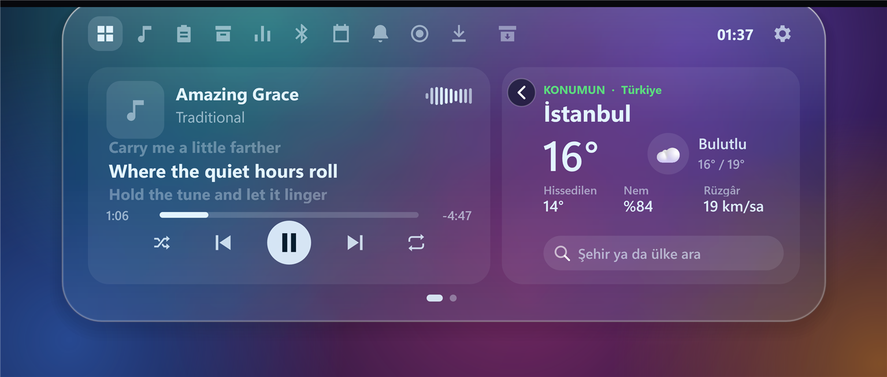

- Zamanlayıcı (süre, kronometre, alarm), pomodoro, hatırlatmalı ajanda ve notlar, yapılacaklar, dünya saati.
- Ana sayfada sürüklenebilir 3B dünya küresi ve hava durumu.

### Temalar ve görünüm

  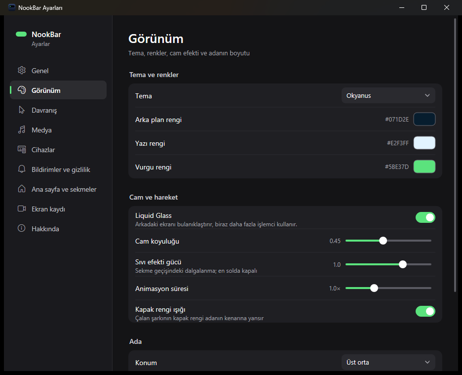

- 14 yerleşik tema, özel arka plan/yazı/vurgu renkleri.
- **Yazı tipi:** sistemdeki yazı tiplerinden seç (aramalı, fare tekerleğiyle kayan liste; her ad kendi yazı tipiyle görünür) ya da kendi TTF/OTF dosyanı yükle. Yüklenen yazı tipi yalnızca NookBar'da kullanılır, Windows'a kurulmaz.

  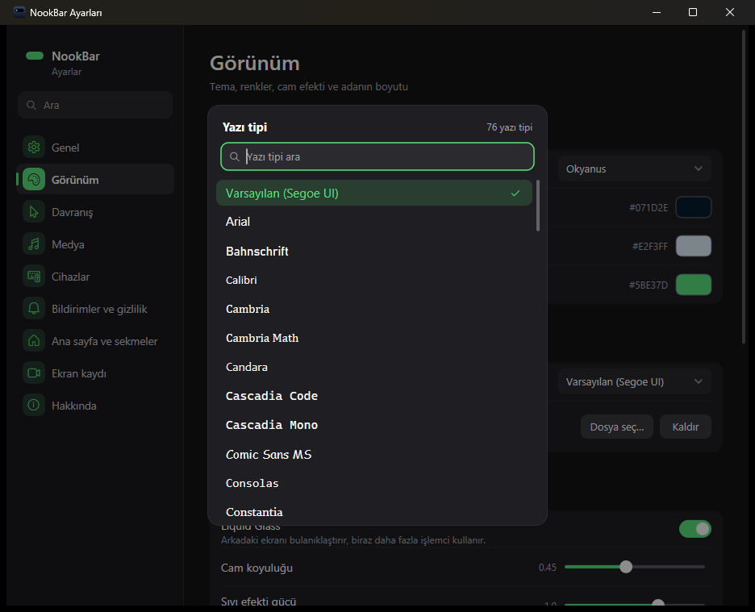

- **Liquid Glass** cam efekti (arkadaki ekranı bulandırıp kırar), sıvı geçiş efekti, kapak renginden vurgu.
- Windows'ta "Saydamlık efektleri" kapalıysa ya da Yüksek Karşıtlık açıksa gövde opak çizilir; "Animasyon efektleri" kapalıysa geçişler en hızlı değere iner.
- Ada boyutu, köşe yuvarlaklığı ve animasyon süresi ayarlanabilir.

### Daha fazla ayar

- **Ayarlar penceresi:** kategorili sol menü, açıklamalı bölümler, az seçenekli ayarlar için segmentli seçim, küçük ekran maketi üzerinde konum seçici ve tüm ayarlar arasında arama (`Ctrl + F`).
- **Kısayollar:** `Ctrl + Alt + D` adayı gösterir/gizler (su damlası animasyonu, Ayarlar → Görünüm'den kapatılabilir); `Ctrl + Alt + Boşluk` paneli açar/kapatır; açıkken ←/→ sekme değiştirir, `Esc` kapatır. Ayarlar penceresi Tab/ok/Boşluk ile klavyeyle de kullanılır.
- **Açılma biçimi:** fareyle üzerine gelince ya da tıklayınca; imleci takip eden ekranda gösterme; yalnızca kenara gidince beliren mod.
- **Gizleme:** tam ekranda ve büyütülmüş pencerede gizle; çift tıkla ince çizgiye indir.
- **Ekran paylaşımı:** ada Discord/OBS/Teams'te görünür; istersen paylaşım ve kayıtlarda gizle.
- **Güncellemeler:** yeni sürüm çıkınca ada bir kez haber verir; tepsi menüsünde ve Ayarlar → Hakkında'da indirme bağlantısı.
- **Dil:** Ayarlar → Genel → Dil (Otomatik, Türkçe, English), tepsi menüsü ya da ilk kurulum.
- **Sekme düzeni:** üst menüdeki sekmeleri sürükleyerek sırala, kullanmadıklarını kutuya bırakıp gizle.

## Desteklenen kablosuz cihazlar

| Marka / aile | Bağlantı |
|---|---|
| Logitech (fare, klavye, G kulaklıklar) | G HUB açıksa ondan, değilse HID++ ile doğrudan |
| Razer (BlackShark V3 / V3 Pro dahil), SteelSeries, Corsair, HyperX, ASUS ROG | 2.4 GHz alıcı / kablo |
| Sony INZONE, Jabra, JBL Quantum, Fractal Scape, MOONDROP | 2.4 GHz alıcı |
| AirPods / Beats, Samsung Galaxy Buds | Bluetooth |
| Glorious, LAMZU, G-Wolves, Hitscan, WLMouse, Pulsar, ATK/VXE, Endgame Gear, ZOWIE, VAXEE, Ninjutso | 2.4 GHz alıcı / kablo |
| Akko ve Rongyuan tabanlı alıcılar, AJAZZ, AULA, MCHOSE, Keychron, Rapoo, Redragon, Delux, Attack Shark | 2.4 GHz alıcı |
| PlayStation (DS4 / DualSense), Xbox, GameSir, Flydigi, Steam Controller | USB / Bluetooth / alıcı |
| Standart HID pil bilgisi veren cihazlar, Android telefon (Bağlantılı Telefon) | — |

Tam liste ve protokol kaynakları: [KAYNAKLAR.md](docs/KAYNAKLAR.md). Cihazın görünmüyorsa [cihaz desteği isteği](../../issues/new/choose) aç.

## Kurulum

Windows 10 ve 11 (x64) gerekir.

1. [Releases](../../releases/latest) sayfasından `NookBar-Setup-<sürüm>.exe` dosyasını indir ve çalıştır.
   - Yönetici izni gerekmez; `%LOCALAPPDATA%\Programs\NookBar` altına kurulur.
   - Ayarların ve notların `%APPDATA%\DinamikAdaNative` klasöründe tutulur (eski adın uyumluluğu için).
2. Windows "Bilinmeyen yayımcı" uyarısı gösterirse **Ek bilgi → Yine de çalıştır** seç. Uygulama henüz kod imzalı değil.
3. **Akıllı Uygulama Denetimi** (Windows Güvenliği → Uygulama ve tarayıcı denetimi) açıksa imzasız uygulamalar engellenebilir.
4. İlk açılışta kısa bir sihirbaz dili, konumu, görünümü ve ana sayfayı sorar.

### Virüs taraması

`NookBar-Setup-1.0.16.exe`, 27.11.2026 tarihli VirusTotal taramasında 69 motorun 66'sında tespit almadı (Kaspersky, ESET, BitDefender dahil). 3 motor uyarı verdi: CrowdStrike Falcon, Microsoft ve SecureAge. 26.11.2026'daki ilk taramada Microsoft temizdi, Rising uyarı veriyordu. Güncel sonuç: [VirusTotal raporu](https://www.virustotal.com/gui/file/2be2e070ecb4067a8f0efa5ef98ccc28a744e95d9b6d2ac5029e36211793b16c).

Bu uyarıları gizlemek yerine burada açıkça paylaşıyoruz:

- Üç uyarıda da belirli bir tehdit ya da davranış gösterilmiyor. CrowdStrike'ınki %60 güvenle verilen otomatik (makine öğrenmesi) bir tahmin; Microsoft'un uyarısı da adındaki `!ml` ekinin gösterdiği gibi makine öğrenmesi modelinden geliyor. NookBar henüz kod imzalı değil ve yeni bir dosya; bu tür otomatik sistemler böyle dosyaları daha sık işaretleyebiliyor.
- 1.0.15 kurulum dosyasını [Hybrid Analysis](https://hybrid-analysis.com/sample/adc1d30348197c7614472a942ea135a2409f57f891a351a7f003ee54f3a08a5a)'te korumalı ortamda da çalıştırdık. Oradaki uyarıların çoğu kurulumun yaptığı işlerle ilgili: programı diske yazmak, "Windows ile başlat" seçeneğini kayıt defterine işlemek, eski "Dinamik Ada" kurulumunu temizlemek. Sitenin genel kararı hâlâ "Malicious"; oradaki 25 antivirüs motorundan tespit veren tek motor CrowdStrike.
- 26.11.2026'da CrowdStrike ve SecureAge'e hem 1.0.15 hem 1.0.16 için yanlış alarm bildirimi gönderdik. 27.11.2026'da 1.0.16'yı Microsoft'a da yanlış alarm olarak gönderdik; inceleme sürüyor. Rising'in bildirim adresine e-postamız ulaşmadı; başka bir yoldan deneyeceğiz. Yanıt geldikçe bu bölümü güncelleyeceğiz.
- Kendi kararını vermen için raporların tamamı yukarıdaki bağlantılarda.

İndirdiğin dosyanın aynı dosya olduğunu SHA-256 özetinden doğrulayabilirsin: `2be2e070ecb4067a8f0efa5ef98ccc28a744e95d9b6d2ac5029e36211793b16c`

## Hızlı başlangıç

1. NookBar ekranın üst ortasında küçük bir ada olarak açılır.
2. Fareyi adanın üzerine getir: panel açılır. Çekince kapanır.
3. Üstteki ikonlardan sekme değiştir (ya da üzerlerinde fare tekerleğini çevir); ana sayfada kartlar sayfa sayfa gezilir.
4. Ayarlar: panelin üstündeki dişli ya da görev çubuğu simgesi. Tüm ipuçları: Ayarlar → Hakkında → Nasıl kullanılır.

## Kaldırma

Windows Ayarları → Uygulamalar → NookBar → Kaldır. Kaldırıcıda "Ayarlarımı ve notlarımı da sil" kutusunu işaretlersen `%APPDATA%\DinamikAdaNative` de silinir.

## Gizlilik

- Pano geçmişi ve bildirimler yalnızca bellekte tutulur, uygulama kapanınca silinir. Yayın/kayıt sırasında (OBS gibi bir uygulama ya da NookBar kaydı) pano ve bildirim metinleri kendiliğinden gizlenir. Discord/Teams ekran paylaşımı algılanamaz; onun için "Ekran paylaşımında ve kayıtlarda gizle" ayarını aç.
- Ağ yalnızca şu özellikler için kullanılır: şarkı sözleri (varsayılan açık; çalan medyanın, tarayıcıdaki videolar dahil, adı, sanatçısı ve süresi LRCLIB'e gider; Ayarlar → Medya → Şarkı sözleri ile kapatılır), hava durumu (Open-Meteo'ya yazdığın şehir), Discord (açarsan, Discord'un oturum sunucusu), güncelleme denetimi (GitHub'a yalnızca son sürüm numarası sorulur; Ayarlar → Hakkında'dan kapatılabilir). Telemetri yok.
- Beklenmedik bir kapanışta kısa bir hata raporu yalnızca bilgisayarında tutulur; hiçbir şey kendiliğinden gönderilmez. İstersen Ayarlar → Hakkında → Hata raporları'ndan teknik özeti (sürüm, Windows, hata kodu) GitHub'da hata bildirimi olarak açabilirsin.
- Söz senkronu için ses yalnızca bellekte ölçülür, kaydedilmez. Öğrenilen söz düzeltmeleri (şarkı adı ve sayılar) yalnızca bilgisayarında, `%APPDATA%\DinamikAdaNative` içinde tutulur.
- İndirme geçmişi (biten indirmelerin dosya adı ve yolu) de yalnızca bilgisayarında, aynı klasörde `downloads.json` içinde tutulur.
- Hata raporları klasöründeki döküm dosyası (.dmp) çökme anındaki bellekten parçalar içerebilir; herkese açık bir hata bildirimine ekleme.
- Discord oturum bilgisi Windows'un kullanıcıya özel şifrelemesiyle (DPAPI) saklanır; NookBar yalnızca gerçekten Discord olan yerel bağlantıya bağlanır.
- Kablosuz cihaz pilleri bilgisayarın içinde okunur; G HUB bağlantısında karşı tarafın gerçekten G HUB olduğu doğrulanır.

## Oyunlar ve hile önleyiciler

NookBar oyunların yanında güvenle çalışacak şekilde yazıldı, ama hiçbir hile önleyici (anti-cheat) bir programı resmî olarak "güvenli" ilan etmez; bu yüzden kesin bir garanti verilemez. Bilmen gerekenler:

- **Oyuna dokunmaz.** Oyunun içine kod enjekte etmez, belleğini okumaz ya da değiştirmez, çekirdek sürücüsü kurmaz. Ada oyunun üstünde ayrı bir pencere olarak çizilir (Discord ve Steam katmanları gibi oyunun içine girmez).
- **Girdiye karışmaz.** Fare/klavye kancası, makro ya da otomatik tıklama yoktur. Tek yapay tuş basma, Discord kısayol düğmelerindedir ve yalnızca Discord öndeyken gönderilir.
- **Oyun modu (varsayılan açık):** tam ekran bir oyun açıkken cam görünümü için ekran kopyalanmaz ve Discord'a tuş gönderilmez. Ayarlar → Davranış → Gizleme → Oyun modu.
- **Tam ekranda gizle (varsayılan açık):** oyun sırasında ada tamamen kaybolur.
- Pil bilgisi kulaklık ve farelerden, üretici programlarının da kullandığı yolla (HID) okunur.
- NookBar'ın kod imzası henüz yok. Çekirdek düzeyindeki sıkı sistemler (Vanguard, FACEIT gibi) imzasız programların oyun üstünde çizilmesini engelleyebilir; bu bir ban değildir, ada yalnızca görünmez. Temkinli olmak istersen rekabetçi maçlardan önce NookBar'ı tepsi menüsünden kapatabilirsin.

## Sorun giderme

**Cihazımın pili görünmüyor.** Modeli [desteklenen cihazlar](#desteklenen-kablosuz-cihazlar) listesinde ara. Yoksa `DINAMIKADA_BATLOG=1` ortam değişkeniyle başlatıp oluşan `%TEMP%\dinamikada_battery.txt` dosyasını bir cihaz desteği isteğine ekle.

**Ada Discord / OBS'te görünüyor.** Varsayılan böyle. Gizlemek için Ayarlar → Bildirimler ve gizlilik → "Ekran paylaşımında ve kayıtlarda gizle".

**Ses çubukları oynamıyor.** Çubuklar Windows'un çaldığı sistem sesine göre çalışır; ses yakalanamazsa animasyona döner. Ayrıca Windows'un Erişilebilirlik → Görsel efektler → Animasyon efektleri ayarına bak.

**Dili nasıl değiştiririm.** Ayarlar → Genel → Dil ya da tepsi simgesine sağ tık → Dil.

**Uygulama açılmıyor / engelleniyor.** Akıllı Uygulama Denetimi imzasız uygulamaları engelleyebilir; [Kurulum](#kurulum) bölümüne bak.

## Geri bildirim

NookBar erken erişim aşamasında. Hataları ve özellik önerilerini [Issues](../../issues) üzerinden bildirebilirsin; cihaz desteği için model ve bağlantı türünü ekle. Bu depo yalnızca kurulum dosyalarını ve belgeleri barındırır.

## Lisans

Telif hakkı © 2026 NookBar. Tüm hakları saklıdır. Ayrıntılar: [LICENSE](LICENSE). Harita verisi Natural Earth (kamu malı); kablosuz cihaz protokol kaynakları [KAYNAKLAR.md](docs/KAYNAKLAR.md) dosyasında.
